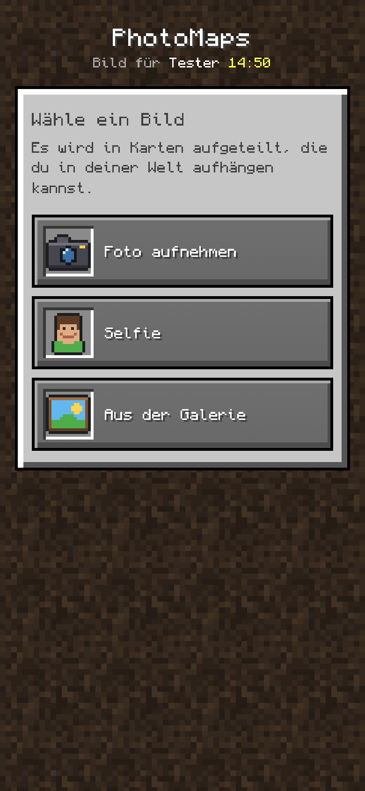
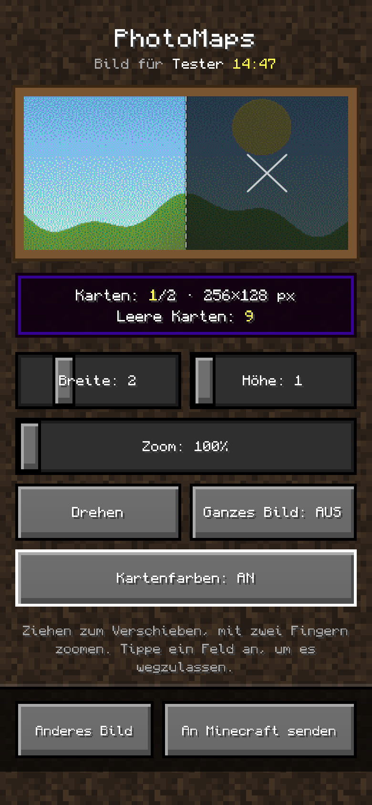
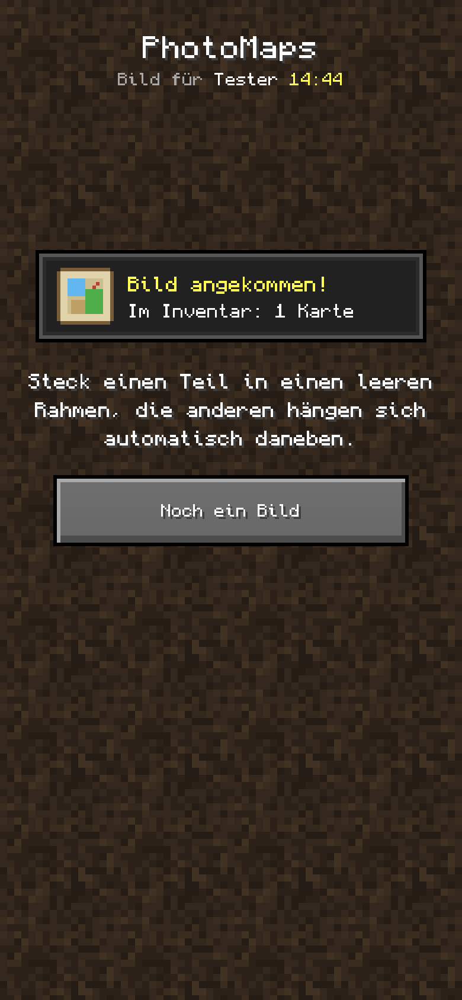
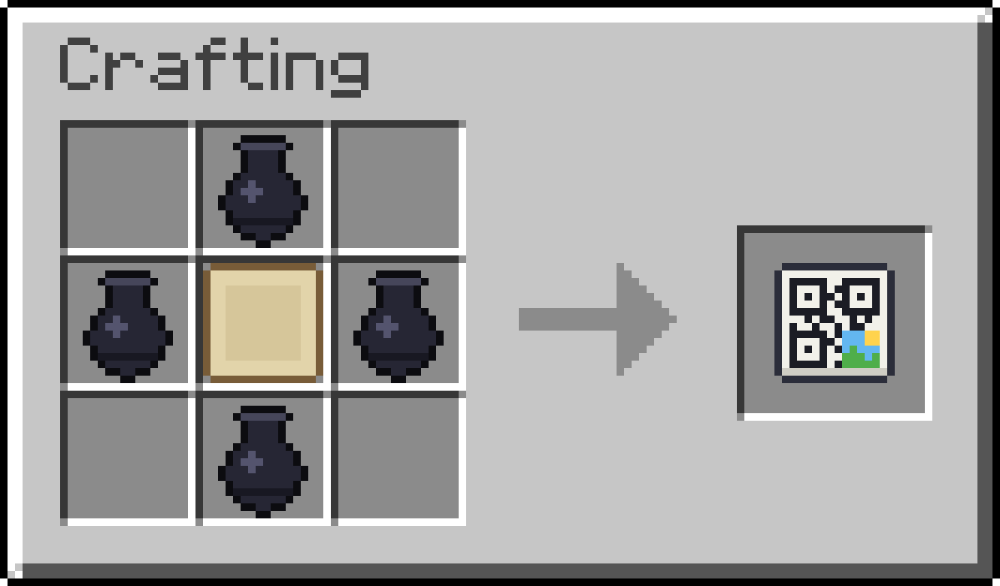

<p align="center">
  
</p>

<h1 align="center">PhotoMaps</h1>

<p align="center">
  <b>Craft a photo code, scan it with your phone, hang your photo on the wall.</b><br>
  A Minecraft server plugin for Paper and Spigot 1.21.4+, for Java and Bedrock players.
</p>

<p align="center">
  <a href="https://github.com/nurkert/photo-maps/releases/latest"></a>
  <a href="https://github.com/nurkert/photo-maps/actions/workflows/ci.yml"></a>
  
  
  <a href="LICENSE"></a>
</p>

<p align="center">
  <a href="https://nurkert.github.io/photo-maps/">Website</a> ·
  <a href="https://nurkert.github.io/photo-maps/wiki/">Wiki</a> ·
  <a href="docs/getting-started.md">Getting started</a> ·
  <a href="docs/security.md">Security and HTTPS</a> ·
  <a href="CHANGELOG.md">Changelog</a>
</p>

<p align="center">
  
  
  
  
</p>

## How it works

1. **Craft a photo code**: four ink sacs around an empty map.

   <p align="center">
     
   </p>

2. **Right-click it**: it turns into a map that shows a QR code. Hold it and scan it with your phone (or click the link
   in chat).
3. **On your phone**: take a photo, a selfie or pick one from your gallery. Choose how many maps wide and high it
   should be, drag and zoom it into place, tap squares you want to leave out and look at the preview in real map
   colours. The page looks and feels like a Minecraft menu.
4. **Send it**: the parts arrive in your inventory as maps. Put one into an empty item frame on a wall and the other
   parts hang themselves into the empty frames around it, each in its place.

Right-click the code map again to renew it. A code belongs to whoever activated it: copies show other players
"Not your photo code" instead of the QR code, and cannot be taken over. In survival, every part of a picture costs one
empty map from your inventory (configurable).

Pictures are stored the moment they arrive, before the maps are handed out, and look exactly the same after
rejoining or restarting the server.

## Java and Bedrock

- The photo code has its own texture. Java players get the resource pack automatically from the plugin's web server
  (it adds files only in its own `photomaps` namespace, next to any other pack). Bedrock players get it through
  Geyser: PhotoMaps copies its Bedrock pack and item mapping into Geyser's folders on startup (or into
  `plugins/PhotoMaps/bedrock` when Geyser runs on a proxy).
- The pictures are vanilla maps, so they look the same on both editions and work in item frames everywhere.
- The code also reacts to right-clicking a block, in case a Bedrock touch screen does not send taps into the air.

## Security

Pictures travel from the phone to the server, so the web server is locked down:

- **HTTPS only** (TLS 1.2 and 1.3). Enter your domain and PhotoMaps gets and renews a **Let's Encrypt** certificate
  by itself, no certbot needed. Your own certificate files work too. Without either, PhotoMaps creates a
  self-signed certificate: just as encrypted, but phones show a warning once. If a certificate cannot be loaded the
  web server stays off rather than falling back to plain HTTP.
- Every upload page needs an **unguessable token** (96 random bits) that expires after 15 minutes. Addresses that
  keep guessing tokens are blocked for a minute.
- Uploads are **checked before they are decoded**: exact pixel size, at most 16 MB, one upload per code at a time.
  The server dithers the picture itself and never trusts the browser's preview.
- The page runs under a strict **Content Security Policy**, loads nothing from other servers (the font is bundled),
  sends HSTS, `nosniff` and `no-referrer`.
- Hanging pictures into neighbouring frames asks protection plugins (WorldGuard etc.) about every single frame.

Turning HTTPS off is only meant for running behind a reverse proxy that does HTTPS; the console warns about it.

## Setup

Drop the jar into `plugins/` and start the server. The console prints the address of the web interface, e.g.
`https://192.168.1.20:8100`, which works for phones in the same network.

For a public server, point a domain at it and enter it. PhotoMaps gets a trusted certificate from Let's Encrypt
and renews it automatically:

```yaml
web:
  port: 8100
  https:
    lets-encrypt:
      domain: "photos.example.com"
```

Open port 8100 (the page) and port 80 (Let's Encrypt's check, only used for a few seconds every two months). See
[Security and HTTPS](docs/security.md) for port forwarding, your own certificate files and reverse proxies.

The resource pack is sent from the GitHub release of the installed version, next to any other pack (it only adds files
in its own `photomaps` namespace), so it needs no port and works with PorticleGun and any server resource pack. To
host it yourself, set `resource-pack.url`, or merge it into your server resource pack and set
`resource-pack.enabled: false`.

All options are explained in [config.yml](src/main/resources/config.yml). Chat texts are in
`messages_en.yml` and `messages_de.yml`; each player sees the language of their client.

## Commands and permissions

| Command | Permission | |
|---|---|---|
| `/photomaps give [player] [amount]` | `photomaps.admin` | give photo codes |
| `/photomaps link` | `photomaps.admin` | open an upload page without a code |
| `/photomaps reload` | `photomaps.admin` | reload config and texts, restart the web server |

| Permission | Default | |
|---|---|---|
| `photomaps.use` | everyone | craft and use photo codes |
| `photomaps.unlimited` | op | uploads cost no empty maps |
| `photomaps.admin` | op | the commands above |

## Documentation

Everything is written down in [docs/](docs) and published as the [wiki](https://nurkert.github.io/photo-maps/wiki/):
[getting started](docs/getting-started.md), [the web interface](docs/web-interface.md),
[configuration](docs/configuration.md), [security and HTTPS](docs/security.md), [Bedrock](docs/bedrock.md),
[commands](docs/commands.md) and [development](docs/development.md) (building, smoke tests, releasing).

## Credits

- QR codes: [QR Code generator library](https://www.nayuki.io/page/qr-code-generator-library) by Project Nayuki (MIT)
- Font of the web interface: [Monocraft](https://github.com/IdreesInc/Monocraft) by Idrees Hassan (SIL Open Font
  License 1.1, see `src/main/resources/web/monocraft-LICENSE.txt`)

PhotoMaps is not affiliated with Mojang or Microsoft. Licensed under the [GPL-3.0](LICENSE).
